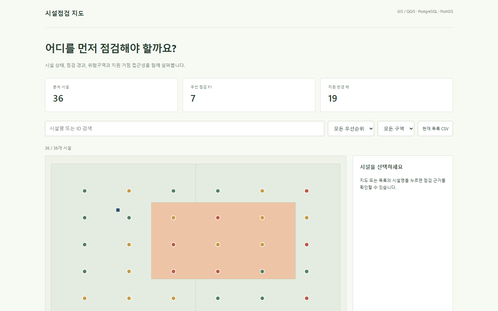
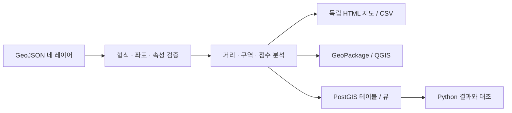

# 시설 점검 우선순위 분석

시설 위치와 최근 점검일, 보수 상태, 지원 거점까지의 거리를 결합해 먼저 점검할 대상을 찾는 GIS 프로젝트입니다. 같은 입력으로 **지도 → CSV → GeoPackage → QGIS 프로젝트 → PostGIS 검증**까지 생성합니다.

공공 시설 유지관리 상황을 가정했습니다. 시설 36개·지원 거점 2개·관리 구역 2개·위험 구역 1개는 직접 작성한 가상 데이터입니다. 실제 기관의 위치·위험도·업무 성과를 나타내지 않습니다.



## 바로 실행

**Python 3.11 이상**, 추가 패키지 없이 실행합니다. 저장소 루트에서 다음 명령을 사용합니다.

```powershell
python run.py analyze
python run.py serve
```

**http://127.0.0.1:8787/** 에서 지도를 엽니다. `output/index.html`을 직접 열어도 필터와 상세 정보가 작동합니다. 외부 지도 API·API 키·CDN이 필요하지 않습니다. 서버는 로컬 주소에서만 실행됩니다.

결과물은 저장소의 [output/](output/)에도 포함했습니다. QGIS에서는 [facility-review.qgs](output/facility-review.qgs)를 열면 같은 폴더의 GeoPackage를 상대 경로로 참조합니다.

## 무엇을 확인할 수 있나

| 기능 | 구현 |
|---|---|
| 입력 검증 | GeoJSON 형식, 필수 속성, ID 중복, 좌표 범위·유한값, 닫힌 링, 날짜 검사 |
| 공간 분석 | 최근접 지원 거점, 거리·반경 포함 여부, 관리 구역, 위험 구역 포함 여부 |
| 우선순위 | 4개 요인의 점수와 시설별 판정 근거 |
| 지도 탐색 | 우선순위·구역·시설 검색, 지도·표 필터 동기화, 마커 선택과 근거 표시 |
| 파일 인계 | 전체·필터 CSV, 분석 GeoJSON, SQLite 기반 GeoPackage, QGIS 프로젝트 |
| DB 재현 | PostGIS 스키마·공간 인덱스·분석 뷰 SQL과 Python 결과 대조 |

## 판단 기준

기본 기준일은 재현성을 위해 `2026-10-25`, 지원 반경은 `750m`로 고정했습니다.

| 조건 | 점수 |
|---|---:|
| 보수 필요 `REPAIR` | 35 |
| 마지막 점검 후 180일 초과 | 25 |
| 가상 위험 구역에 포함 | 25 |
| 가장 가까운 지원 거점의 반경 밖 | 15 |

합계 **60점 이상 P1**, **30점 이상 P2**, 나머지는 P3입니다. 점수는 이 프로젝트에서 정한 예시 규칙입니다. 지도에서 시설을 누르면 점수와 판정 근거를 확인합니다.

```powershell
python run.py analyze --as-of 2026-10-26 --radius 1000 --output output-custom
```

기본 데이터의 결과는 **시설 36개 / P1 7개 / 지원 반경 밖 19개**입니다. 반경을 늘리면 반경 밖 시설 수가 증가하지 않는 성질도 테스트합니다.

## 좌표와 거리

입력·출력은 **WGS84 경도·위도 / EPSG:4326**입니다. Python은 지구 반지름 6,371,008.8m의 구면 Haversine 거리를 계산합니다. 경위도 좌표의 차이를 그대로 미터로 해석하지 않습니다. 구역 경계는 포함하고, 폴리곤 구멍 내부는 제외합니다.

PostGIS는 `geography`의 타원체 거리와 `ST_DWithin`을 사용합니다. 두 거리 모델은 차이가 있으므로 **같은 좌표에서도 반경 경계 부근의 판정은 달라질 수 있습니다**. 이번 36개 표본은 모든 판정·점수가 일치했고, 거리 차이의 최댓값은 **3.4849m**였습니다. 이 수치는 표본 비교 결과이며 측량 정확도 보증이 아닙니다.

## PostGIS에서 재현

Docker와 `psql` 클라이언트가 있는 경우:

```powershell
docker compose up -d --wait
$env:PGHOST='127.0.0.1'
$env:PGPORT='55432'
$env:PGUSER='portfolio'
$env:PGDATABASE='portfolio'
$env:PGPASSWORD='portfolio-demo-only'
python run.py database-check
```

기본 비밀번호는 로컬 시연 전용입니다. Compose의 `POSTGRES_PASSWORD`와 `PGPASSWORD`를 함께 변경할 수 있습니다. 기존 PostgreSQL을 사용하려면 연결 환경변수를 바꾸고 PostGIS 확장 생성 권한을 준비합니다. `--psql`로 실행 파일 경로를 지정할 수 있습니다.

SQL은 **`portfolio` 스키마의 네 입력 테이블을 현재 데이터 전체로 교체**합니다. 다른 업무 데이터가 없는 전용 시연 DB를 사용하세요. 트랜잭션으로 입력을 교체하고 공간 인덱스와 분석 뷰를 생성합니다. 다시 분석하면 이전 DB 검증 기록을 지우므로 새 결과는 `database-check`로 다시 확인해야 합니다.

검증 명령은 모든 ID·최근접 거점·포함 여부·점수·우선순위를 대조하고 거리 차이도 검사합니다. 결과는 [database-check.json](output/database-check.json)에 기록됩니다. 이번 검증은 Docker 대신 로컬 **PostgreSQL 17.11 / PostGIS 3.6.2**에서 실제 실행했습니다.

## 결과물과 구조



| 파일 | 용도 |
|---|---|
| `data/*.geojson` | 원본 가상 데이터 / [데이터 설명](data/README.md) |
| `gis_portfolio/analysis.py` | 입력 검증·분석 규칙·CSV |
| `gis_portfolio/geopackage.py` | GeoPackage 바이너리 geometry와 QGIS XML |
| `gis_portfolio/postgis.py` | SQL 생성·실제 DB 대조 |
| `gis_portfolio/report.py` | 독립형 SVG 지도·검색 UI |
| `output/report.json` | 기준일·반경·거리 모델·시설별 결과 |
| `output/analysis.gpkg` | 4개 피처 테이블과 EPSG:4326 메타데이터 |
| `output/facility-review.qgs` | 상대 경로 레이어와 우선순위 스타일 |

## 검증

```powershell
python -m unittest discover -s tests -v
```

2026-10-26 Python 3.13에서 **21개 테스트 통과**. 알려진 거리·대칭성, 폴리곤 경계와 구멍, 잘못된 좌표·날짜·ID·geometry, 점수·재현성·반경 변화, CSV 수식·HTML 삽입 보호, GeoPackage 무결성·geometry 헤더, QGIS XML·출력 경로·이전 DB 검증 기록 무효화를 검사했습니다.

실제 Chrome에서 **10개 화면 검사**를 통과했습니다. 1440px / 390px의 레이아웃, 36개 결과, P1 필터와 지도 동기화, 선택 상세, 검색 결과 없음을 확인했습니다.

```powershell
powershell -ExecutionPolicy Bypass -File scripts/test-browser.ps1
```

[GitHub Actions 설정 템플릿](docs/ci/verify.yml)은 표준 라이브러리 테스트와 산출물 생성을 실행하도록 작성했습니다. 현재 연결된 토큰에는 `workflow` 권한이 없어 자동 실행 등록은 제외했습니다. PostGIS 대조는 DB가 준비된 환경에서 별도로 실행합니다. [검증 기록과 한계](docs/verification.md)

## 적용 범위

소규모 가상 데이터의 재현 가능한 분석·인계 도구입니다. 경로 탐색·이동 시간·실제 재해 예측·국가 좌표계 변환·대용량 분산 처리는 포함하지 않습니다. 입력은 Point와 단순 Polygon에 한정하며 전체 OGC topology 유효성 검사기를 대신하지 않습니다. QGIS 프로젝트는 XML·상대 경로·GeoPackage 구조까지 검사했고 **QGIS 데스크톱에서 직접 열어보는 검증은 수행하지 않았습니다**.

참고: [PostGIS ST_DWithin](https://postgis.net/docs/ST_DWithin.html), [ST_Covers](https://postgis.net/docs/ST_Covers.html), [OGC GeoPackage](https://www.geopackage.org/spec/)
